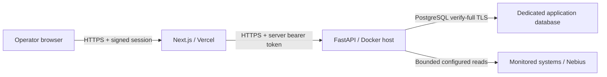

# Deploying the single-operator release

This is an implementation and rollout guide. On 18 October 2026, the selected
Supabase session pooler was verified using full TLS validation, application
migrations reached `0005_verified_recovery`, and the restricted runtime login and
table privileges passed live verification. Backend/frontend cloud deployment,
Linux Docker image execution and live monitored-provider validation remain pending.
Docker is not installed in the current Windows environment.

## Topology



The public `/` explains the product. `/dashboard` and its three data handlers
require the operator session in production. `/login` accepts a generated operator
key, not provider credentials. The browser never receives the backend token,
signing key, PostgreSQL URL or provider secrets. The backend exposes only process
liveness and readiness publicly, with exact allowed Host enforcement.

The release is for one trusted operator and one organization. It has no customer
accounts, tenant isolation, MFA, SSO, password reset, individual roles or per-user
audit identity. Do not give the shared operator key to multiple customers.

## 1. Prepare accounts and destinations

The original roadmap uses Vercel for Next.js and Supabase PostgreSQL for application
storage. Render is a concrete Docker-compatible backend option for the rollout;
another compatible host can run the same image. Accounts, projects, domain names,
budget and service settings must be selected before provisioning anything.

Use a dedicated application database and restricted role. These are separate
from the monitored `POSTGRES_*` credentials. Prefer a direct or session-mode
connection for migrations; verify the project's connection mode, network support
and CA certificate against the current provider settings. Do not silently switch
to transaction pooling or disable certificate verification to make it connect.
Do not expose the `reliability` schema through Supabase's public Data API.

## 2. Prepare runtime secrets

```powershell
. .\scripts\environment.ps1
& $ProjectPython .\scripts\deployment-keys.py
```

The generator saves a new, ignored `work/deployment-secrets/keys-*.json`, never
overwrites `.env`, never prints values, and never changes deployed credentials.
Protect the file with the OS account's ACLs and transfer values to the platform
secret manager/password manager. Windows access is governed by ACLs; chmod alone
does not establish private Windows permissions. Do not commit/upload the bundle.

`deploy/frontend.env.example` and `deploy/backend.env.example` enumerate settings.
Never prefix secrets with `NEXT_PUBLIC_`. Use distinct random 32-byte operator,
signing and backend keys. The frontend receives only the operator key's SHA-256
digest; the operator keeps the original key. `API_ACCESS_TOKEN` and
`RELIABILITY_BACKEND_TOKEN` receive the same backend service key. The signing key
is separate. Use the exact canonical HTTPS frontend/backend origins, with no paths,
credentials or query parameters. Configure `API_ALLOWED_HOSTS` with the exact
backend hostname (and port if externally nonstandard); wildcard hosts are rejected.

For PostgreSQL use a `postgresql+psycopg://` URL with percent-encoded credentials
and no query parameters. Non-loopback connections always use `sslmode=verify-full`.
If the project requires its own CA, mount its downloaded public certificate and
set `STORAGE_SSL_CA_FILE` to that absolute path. The file is parsed and bounded to
128 KiB. Without a custom CA, the certifi trust bundle is used. A CA mismatch must
fail; it is not a reason to use `require` or disable TLS verification.

## 3. Build and verify images on a Docker host

From the repository root:

```text
docker build --pull -f backend/Dockerfile -t reliability-backend:phase14 .
docker build --pull -t reliability-frontend:phase14 frontend
```

The backend context allowlist excludes `.env`, work, Git, development environments
and frontend files. Dependencies use the existing hash-pinned requirements. The
frontend uses `npm ci`, a release webpack build and Next.js standalone output;
only the standalone trace/static assets enter its final image. Both final images
run as non-root users and contain process health commands. Chromium fixture tools
stay disabled in production; no browser binary is installed in the backend image.

Base images track Python 3.12 and Node 24 Debian releases. Resolve and record their
digests, scan the built images, and verify Linux behavior before promotion; these
steps remain unperformed here. A Windows standalone HTTP test does not verify a
Linux container image. Run with dropped capabilities, no new privileges, bounded
CPU/memory, an init process, and at least 180 seconds graceful shutdown. If using a
read-only filesystem, provide bounded temporary writable storage where required.

## 4. Explicit migration and backend startup

Run the migration as a separate, controlled release operation using the same image
and a database migration role. Back up the database first. Example command inside
that container's `/app/backend` working directory:

```text
python -m app.db.cli upgrade
python -m app.db.cli status
```

Then start the normal image command, `python -m app.serve`. It validates production
access configuration and PostgreSQL storage before binding, starts one worker,
disables access logs and proxy-header trust, bounds concurrency, and allows worker
draining during shutdown. Startup never creates or migrates schema.

Use a dedicated runtime role with only the required schema/table/sequence grants;
it should not be the database owner or a Supabase service-role API key. Apply
future migrations separately with the migration role, and back up/restore-test
history. The application intentionally offers no SQL or migration HTTP endpoint.

For Render, use the repository root as Docker context, `backend/Dockerfile`, the
normal Docker CMD, secret settings and `/ready` as the health-check path. When
`API_ALLOWED_HOSTS` is omitted and Render sets `RENDER=true`, startup and the image
health probe use Render's `RENDER_EXTERNAL_HOSTNAME` as the one exact allowed host.
Missing or malformed Render metadata stops startup; request/forwarded headers
cannot supply this configuration. Explicit `API_ALLOWED_HOSTS` always takes precedence,
including an explicitly empty list, and other hosts still require explicit configuration.
For custom domains, explicitly configure their exact hosts and the assigned Render
host as needed; no wildcard or request-derived fallback exists.

The image includes Supabase's public production root CA at
`/app/backend/certs/supabase-ca.crt`. Select it with `STORAGE_SSL_CA_FILE` for the
verified Supabase deployment. It contains no private key or service credentials;
see `backend/certs/README.md` for its official source and fingerprint. Other database
providers can continue using certifi or an explicitly mounted CA.

Ensure the edge preserves the exact configured Host. Provider pre-deploy hooks may be
used if the selected service supports them; otherwise run the explicit migration
as a controlled one-off operation. No blueprint provisions a paid plan here.

Keep retry/recovery disabled in production. All fixture modes are rejected there.
Incidents can be enabled only with configured production access and storage, but
are off in the provided template. Investigation/model/provider reads remain opt-in.
The production tool catalog contains 12 bounded read tools; the synthetic browser
fixture tool is excluded. Local mode retains its 13-tool catalog.

## 5. Frontend hosting

For Vercel, set project root to `frontend`, use Node 24, `npm ci` and `npm run build`,
and supply only frontend template variables through server environment settings.
Runtime instrumentation rejects invalid production origins/keys. Set a stable
canonical domain matching `RELIABILITY_PUBLIC_ORIGIN`; other hosts cannot open an
authenticated workspace. Do not reuse production secrets in preview deployments.

The investigation route declares `maxDuration=130` seconds, covering its bounded
125-second backend fetch. Verify the actual plan, function mode and edge/request
timeouts can support it before enabling live investigation. The backend uses its
existing 120-second investigation budget. No scheduler or automatic polling is
introduced. One backend instance/worker is supported; investigation concurrency
limits are per process, including during any rollout overlap.

A Docker frontend is an alternative: its CMD is `node server.js`, with HOSTNAME
`0.0.0.0` and PORT `3000` by default. Put both container listeners behind a managed
HTTPS edge or authenticated private network. Direct cleartext container ports must
not be exposed publicly. The Docker port declaration is not a TLS terminator.

## 6. Authentication, CORS and limitations

- Login uses a high-entropy generated key, constant-time digest comparison and a
  fixed eight-hour HMAC session bound to the canonical origin and operator digest.
  Cookie: `__Host-`, Secure, HttpOnly, SameSite=Strict, Path=/, no Domain. Login,
  logout and investigations require exact Origin plus JSON; cross-site requests
  and forwarded-host substitutions fail. Authentication also runs in each API
  handler and the server dashboard page, not solely middleware.
- Sign-out expires that browser's cookie. Stateless sessions copied elsewhere
  remain valid until expiry; rotate the signing key or operator digest to revoke
  all sessions. This is an explicit single-operator tradeoff, not per-session
  revocation. Keep signing secrets stable across trusted frontend instances.
- Login burst control is 10 attempts per instance, refilling one/minute. Backend
  authenticated traffic has a 120-request burst/refill of two/second per process.
  These are not distributed/IP quotas. Configure the hosting edge for request/body
  limits, slow-client protection and shared login throttling before public exposure.
- The browser calls only its own Next.js origin. Backend requests originate on
  the frontend server with its bearer token. The API rejects all browser Origins
  and enables no CORS allowlist. Do not add wildcard CORS or send the service key
  to the browser. CSP restricts sources, frames, objects, forms and connections;
  Next.js inline bootstrapping/styles require `unsafe-inline` in this baseline.
  It is not a nonce-based strict CSP. HSTS, no-referrer, nosniff and frame denial
  are included; API/history responses are not cached.
- Remediation approval, retry, recovery verification and incident resolution have
  no browser/model HTTP write routes. Production retry/recovery settings remain
  rejected even when authenticated. Scoped proof never establishes customer delivery.

## 7. Readiness, smoke and rollback

`GET /health` is process liveness only. `GET /ready` requires configured production
access and storage at revision `0005_verified_recovery`, with a three-second wait
limit. A pending check is reused/drained instead of spawning unlimited workers.
Disabled/unreachable/unmigrated storage returns 503. Readiness does not poll any
provider or claim that monitored services are healthy. Frontend `/api/health`
reports frontend process liveness only.

Locally, after building the frontend:

```powershell
.\scripts\deployment-smoke.ps1
```

This uses real standalone Next.js, real Uvicorn, disposable generated certificates
and explicit CA trust on both HTTPS connections. No certificate verification is
disabled. It verifies login, signed cookies, logout, server bearer auth, host/origin
guards, history-failure separation, no browser-secret exposure and absent remediation
routes. Its production-mode backend intentionally has disabled storage, so readiness
must be 503. SQLite/PostgreSQL schema readiness is separately regression-tested.

After actual hosting is selected/configured, run `scripts/deployed-smoke.py` with
the two canonical URLs and existing operator/backend secrets in process environment.
It makes no monitoring, investigation or remediation calls. Promote only after
actual readiness, login/history and TLS checks pass. The deployed smoke is prepared
but has not run against a cloud host.

Roll back application images to a previously verified commit if startup/readiness
fails. Do not automatically downgrade the database or remove recovery history.
Use compatible schema versions and a separately planned backup restore if required.

## Official references checked 17 October 2026

- [Next.js self-hosting](https://nextjs.org/docs/app/guides/self-hosting)
- [FastAPI Docker deployment](https://fastapi.tiangolo.com/deployment/docker/)
- [Docker build guidance](https://docs.docker.com/build/building/best-practices/)
- [Render Docker](https://render.com/docs/docker) and [health checks](https://render.com/docs/health-checks)
- [Vercel function duration](https://vercel.com/docs/functions/configuring-functions/duration)
- [Supabase connections](https://supabase.com/docs/guides/database/connecting-to-postgres)
  and [SSL enforcement](https://supabase.com/docs/guides/platform/ssl-enforcement)
